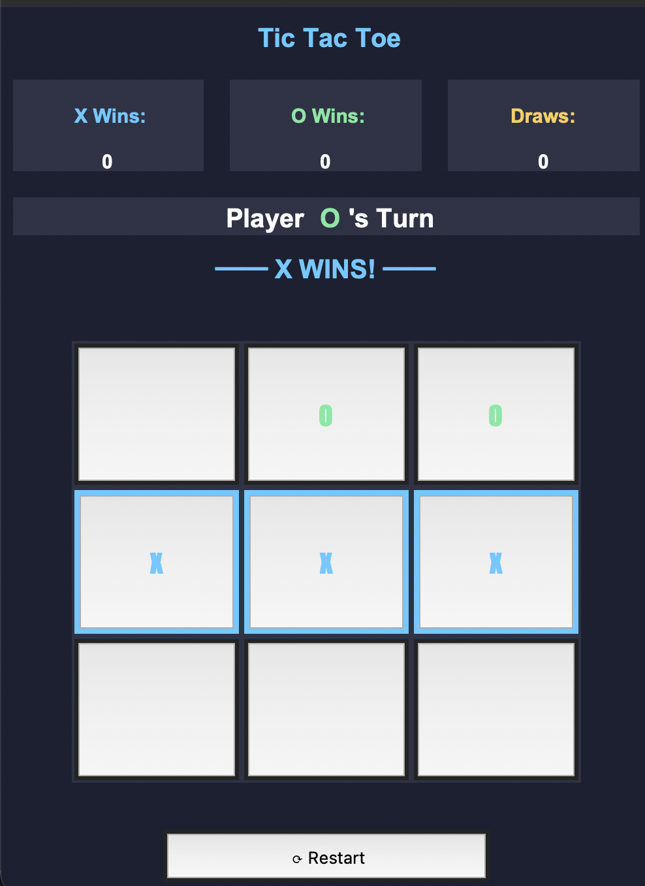

# 🎮 TIC-TAC-TOE

## 📸 Screenshot



A Tic-Tac-Toe game built using Python, Tkinter, and Pygame, featuring sound effects, background music, and a scoreboard.

## ✨ Features

- 🎯 Interactive Tic-Tac-Toe gameplay
- 🔊 Sound effects for clicks and game results
- 🎵 Background music
- 🏆 Scoreboard to track game scores
- 🖥️ Graphical user interface using Tkinter

## 🛠️ Technologies Used

- Python
- Tkinter
- Pygame

## 📁 Project Structure

```text
TIC-TAC-TOE/
├── Sounds/
│   ├── click.mp3
│   ├── click2.mp3
│   ├── victory.mp3
│   ├── draw.mp3
│   └── theme.mp3
├── Tictactoe.py
├── .gitignore
└── README.md
```

## ⚙️ Requirements

- Python 3
- Pygame

Tkinter is also required. It is included with many Python installations.

## 🚀 How to Run

### 1. Clone the repository

```bash
git clone https://github.com/karannn0720/TIC-TAC-TOE.git
```

### 2. Open the project folder

```bash
cd TIC-TAC-TOE
```

### 3. Install Pygame

```bash
python3 -m pip install pygame
```

### 4. Run the game

```bash
python3 Tictactoe.py
```

**Note:** Keep the `Sounds` folder in the same directory as `Tictactoe.py` so the game can find its audio files.

## 🎯 Project Goal

This project was created to practice Python programming, GUI development, and sound integration.

## 👨‍💻 Author

Karan

---

⭐ If you like this project, consider giving the repository a star!
